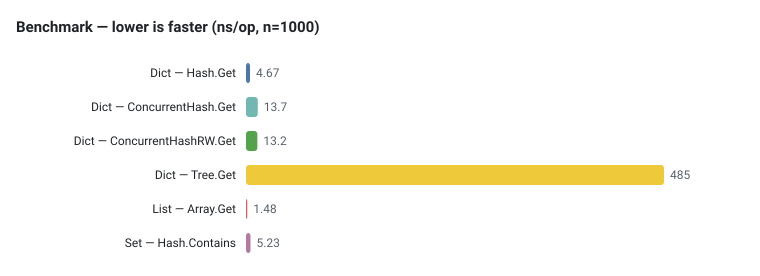

# Benchmark report

<!-- Generated by tools/benchreport — do not edit by hand. Regenerate with `make bench-report`. -->

This report is the full companion to the headline preview in the [README](README.md#performance). It surfaces two environments: a controlled **reference** machine (the trustworthy baseline) and the **CI** shared runner (indicative). Each is regenerated independently — the reference by a maintainer running `make bench-report` locally, the CI numbers on every push to `main`.

## Environments

### Reference — Framework Desktop (primary)

- **Machine:** Framework Desktop · AMD Ryzen AI MAX+ 395 · 128 GB unified memory · Arch Linux
- **Commit:** `31d657d`
- **Generated (UTC):** 2026-06-16T19:23:20Z
- **Go:** go1.25.5
- **Runner:** linux/amd64
- **CPU:** AMD RYZEN AI MAX+ 395 w/ Radeon 8060S
- **Flags:** `-benchtime=30ms -count=4 -benchmem`
- **Packages:** github.com/pickeringtech/go-collections/collections/dicts, github.com/pickeringtech/go-collections/collections/lists, github.com/pickeringtech/go-collections/collections/sets

### CI — GitHub-hosted runner (ubuntu-latest) (secondary)

- **Machine:** shared ubuntu-latest runner (noisy)
- **Commit:** `84c3e6e`
- **Generated (UTC):** 2026-10-24T00:08:45Z
- **Go:** go1.24.13
- **Runner:** linux/amd64
- **CPU:** AMD EPYC 7763 64-Core Processor
- **Flags:** `-benchtime=50ms -count=8 -benchmem`
- **Packages:** github.com/pickeringtech/go-collections/collections/deques, github.com/pickeringtech/go-collections/collections/dicts, github.com/pickeringtech/go-collections/collections/heaps, github.com/pickeringtech/go-collections/collections/lists, github.com/pickeringtech/go-collections/collections/lru, github.com/pickeringtech/go-collections/collections/multimaps, github.com/pickeringtech/go-collections/collections/sets, github.com/pickeringtech/go-collections/collections/sketches, github.com/pickeringtech/go-collections/collections/sketches/bloom, github.com/pickeringtech/go-collections/collections/sketches/countmin, github.com/pickeringtech/go-collections/collections/sketches/hll, github.com/pickeringtech/go-collections/collections/sketches/tdigest, github.com/pickeringtech/go-collections/collections/streaming

> ⚠️ The **CI** environment is a shared, noisy GitHub-hosted runner, so its numbers are **indicative, not authoritative** — trust them for orders of magnitude and relative comparisons only. The **reference** environment is a fixed, controlled machine and is the baseline the headline table and chart are drawn from.

## Headlines — Reference — Framework Desktop



| Operation | ns/op | B/op | allocs/op |
|---|--:|--:|--:|
| Dict — Hash.Get | 4.44 | 0 | 0 |
| Dict — ConcurrentHash.Get | 12.8 | 0 | 0 |
| Dict — ConcurrentHashRW.Get | 12.6 | 0 | 0 |
| Dict — Tree.Get | 411 | 0 | 0 |
| List — Array.Get | 1.41 | 0 | 0 |
| Set — Hash.Contains | 5.23 | 0 | 0 |

## Full results — Reference — Framework Desktop

### dicts

#### Filter

| Implementation | Size | ns/op | B/op | allocs/op |
|---|--:|--:|--:|--:|
| Hash | 10 | 99.1 | 0 | 0 |
| Hash | 100 | 1,946 | 3,208 | 7 |
| Hash | 1,000 | 27,509 | 54,152 | 15 |

#### ForEach

| Implementation | Size | ns/op | B/op | allocs/op |
|---|--:|--:|--:|--:|
| Hash | 10 | 60.8 | 0 | 0 |
| Hash | 100 | 411 | 0 | 0 |
| Hash | 1,000 | 5,224 | 0 | 0 |
| Hash | 10,000 | 47,034 | 0 | 0 |

#### Get

| Implementation | Size | ns/op | B/op | allocs/op |
|---|--:|--:|--:|--:|
| ConcurrentHash | 10 | 12.6 | 0 | 0 |
| ConcurrentHash | 100 | 12.7 | 0 | 0 |
| ConcurrentHash | 1,000 | 12.8 | 0 | 0 |
| ConcurrentHash | 10,000 | 13.0 | 0 | 0 |
| ConcurrentHashRW | 10 | 12.5 | 0 | 0 |
| ConcurrentHashRW | 100 | 12.7 | 0 | 0 |
| ConcurrentHashRW | 1,000 | 12.6 | 0 | 0 |
| ConcurrentHashRW | 10,000 | 12.9 | 0 | 0 |
| Hash | 10 | 3.81 | 0 | 0 |
| Hash | 100 | 4.13 | 0 | 0 |
| Hash | 1,000 | 4.44 | 0 | 0 |
| Hash | 10,000 | 5.31 | 0 | 0 |
| Tree | 10 | 4.58 | 0 | 0 |
| Tree | 100 | 47.5 | 0 | 0 |
| Tree | 1,000 | 411 | 0 | 0 |
| Tree | 10,000 | 4,018 | 0 | 0 |

#### Put

| Implementation | Size | ns/op | B/op | allocs/op |
|---|--:|--:|--:|--:|
| Hash | 10 | 565 | 937 | 7 |
| Hash | 100 | 4,445 | 10,230 | 13 |
| Hash | 1,000 | 53,409 | 163,651.5 | 26 |

#### PutInPlace

| Implementation | Size | ns/op | B/op | allocs/op |
|---|--:|--:|--:|--:|
| Hash | 10 | 177 | 34 | 2 |
| Hash | 100 | 212 | 48 | 2 |
| Hash | 1,000 | 444 | 266 | 2 |
| Hash | 10,000 | 1,252 | 2,478 | 3 |
| Tree | 10 | 206 | 82 | 2 |
| Tree | 100 | 342 | 92 | 3 |
| Tree | 1,000 | 1,256 | 216 | 3 |

#### Remove

| Implementation | Size | ns/op | B/op | allocs/op |
|---|--:|--:|--:|--:|
| Hash | 10 | 518 | 912 | 6 |
| Hash | 100 | 4,445 | 10,192 | 12 |
| Hash | 1,000 | 52,632 | 163,368 | 25 |

#### RemoveInPlace

| Implementation | Size | ns/op | B/op | allocs/op |
|---|--:|--:|--:|--:|
| Hash | 10 | 46.3 | 0 | 0 |
| Hash | 100 | 54.8 | 0 | 0 |
| Hash | 1,000 | 77.1 | 0 | 0 |
| Hash | 10,000 | 205 | 0 | 0 |

### lists

#### Filter

| Implementation | Size | ns/op | B/op | allocs/op |
|---|--:|--:|--:|--:|
| Array | 10 | 67.7 | 120 | 4 |
| Array | 100 | 271 | 1,016 | 7 |
| Array | 1,000 | 2,337 | 8,184 | 10 |
| Array | 10,000 | 19,687 | 128,248 | 16 |
| DoublyLinked | 10 | 69.2 | 120 | 4 |
| DoublyLinked | 100 | 285 | 1,016 | 7 |
| DoublyLinked | 1,000 | 2,366 | 8,184 | 10 |
| DoublyLinked | 10,000 | 25,396 | 128,248 | 16 |
| Linked | 10 | 66.9 | 120 | 4 |
| Linked | 100 | 310 | 1,016 | 7 |
| Linked | 1,000 | 2,319 | 8,184 | 10 |
| Linked | 10,000 | 25,746 | 128,248.5 | 16 |

#### ForEach

| Implementation | Size | ns/op | B/op | allocs/op |
|---|--:|--:|--:|--:|
| Array | 10 | 30.1 | 24 | 2 |
| Array | 100 | 148 | 24 | 2 |
| Array | 1,000 | 1,201 | 24 | 2 |
| Array | 10,000 | 11,813 | 24 | 2 |
| DoublyLinked | 10 | 31.4 | 24 | 2 |
| DoublyLinked | 100 | 145 | 24 | 2 |
| DoublyLinked | 1,000 | 1,352 | 24 | 2 |
| DoublyLinked | 10,000 | 10,150 | 24 | 2 |
| Linked | 10 | 30.8 | 24 | 2 |
| Linked | 100 | 139 | 24 | 2 |
| Linked | 1,000 | 1,642 | 24 | 2 |
| Linked | 10,000 | 10,490 | 24 | 2 |

#### Get

| Implementation | Size | ns/op | B/op | allocs/op |
|---|--:|--:|--:|--:|
| Array | 10 | 1.39 | 0 | 0 |
| Array | 100 | 1.41 | 0 | 0 |
| Array | 1,000 | 1.41 | 0 | 0 |
| Array | 10,000 | 1.39 | 0 | 0 |
| DoublyLinked | 10 | 2.07 | 0 | 0 |
| DoublyLinked | 100 | 8.75 | 0 | 0 |
| DoublyLinked | 1,000 | 170 | 0 | 0 |
| DoublyLinked | 10,000 | 2,302 | 0 | 0 |
| Linked | 10 | 2.51 | 0 | 0 |
| Linked | 100 | 24.7 | 0 | 0 |
| Linked | 1,000 | 440 | 0 | 0 |
| Linked | 10,000 | 4,245 | 0 | 0 |

#### Push

| Implementation | Size | ns/op | B/op | allocs/op |
|---|--:|--:|--:|--:|
| Array | 10 | 89.7 | 160 | 1 |
| Array | 100 | 156 | 1,792 | 1 |
| Array | 1,000 | 505 | 12,288 | 1 |
| DoublyLinked | 10 | 76.7 | 24 | 1 |
| DoublyLinked | 100 | 77.3 | 24 | 1 |
| DoublyLinked | 1,000 | 86.8 | 24 | 1 |
| Linked | 10 | 77.0 | 24 | 1 |
| Linked | 100 | 76.1 | 24 | 1 |
| Linked | 1,000 | 87.3 | 24 | 1 |

### sets

#### Add

| Implementation | Size | ns/op | B/op | allocs/op |
|---|--:|--:|--:|--:|
| ConcurrentHash | 10 | 52.4 | 0 | 0 |
| ConcurrentHash | 100 | 58.0 | 0 | 0 |
| ConcurrentHash | 1,000 | 63.3 | 0 | 0 |
| ConcurrentHashRW | 10 | 57.3 | 0 | 0 |
| ConcurrentHashRW | 100 | 63.6 | 0 | 0 |
| ConcurrentHashRW | 1,000 | 71.2 | 0 | 0 |
| Hash | 10 | 41.7 | 0 | 0 |
| Hash | 100 | 48.7 | 0 | 0 |
| Hash | 1,000 | 53.6 | 0 | 0 |

#### Contains

| Implementation | Size | ns/op | B/op | allocs/op |
|---|--:|--:|--:|--:|
| ConcurrentHash | 10 | 12.1 | 0 | 0 |
| ConcurrentHash | 100 | 12.1 | 0 | 0 |
| ConcurrentHash | 1,000 | 12.6 | 0 | 0 |
| ConcurrentHash | 10,000 | 12.6 | 0 | 0 |
| ConcurrentHashRW | 10 | 12.1 | 0 | 0 |
| ConcurrentHashRW | 100 | 12.3 | 0 | 0 |
| ConcurrentHashRW | 1,000 | 13.1 | 0 | 0 |
| ConcurrentHashRW | 10,000 | 13.1 | 0 | 0 |
| Hash | 10 | 4.51 | 0 | 0 |
| Hash | 100 | 4.84 | 0 | 0 |
| Hash | 1,000 | 5.23 | 0 | 0 |
| Hash | 10,000 | 5.92 | 0 | 0 |

#### ForEach

| Implementation | Size | ns/op | B/op | allocs/op |
|---|--:|--:|--:|--:|
| ConcurrentHash | 10 | 105 | 24 | 2 |
| ConcurrentHash | 100 | 515 | 24 | 2 |
| ConcurrentHash | 1,000 | 6,049 | 24 | 2 |
| ConcurrentHash | 10,000 | 54,036 | 24 | 2 |
| ConcurrentHashRW | 10 | 102 | 24 | 2 |
| ConcurrentHashRW | 100 | 526 | 24 | 2 |
| ConcurrentHashRW | 1,000 | 6,152 | 24 | 2 |
| ConcurrentHashRW | 10,000 | 56,006 | 24 | 2 |
| Hash | 10 | 97.0 | 24 | 2 |
| Hash | 100 | 506 | 24 | 2 |
| Hash | 1,000 | 5,926 | 24 | 2 |
| Hash | 10,000 | 56,248 | 24 | 2 |

## Full results — CI — GitHub-hosted runner (ubuntu-latest) (indicative)

### dicts

#### Filter

| Implementation | Size | ns/op | B/op | allocs/op |
|---|--:|--:|--:|--:|
| Hash | 10 | 217 | 0 | 0 |
| Hash | 100 | 4,258 | 3,208 | 7 |
| Hash | 1,000 | 58,932 | 54,152 | 15 |

#### ForEach

| Implementation | Size | ns/op | B/op | allocs/op |
|---|--:|--:|--:|--:|
| Hash | 10 | 139 | 0 | 0 |
| Hash | 100 | 868 | 0 | 0 |
| Hash | 1,000 | 10,591 | 0 | 0 |
| Hash | 10,000 | 95,798 | 0 | 0 |

#### Get

| Implementation | Size | ns/op | B/op | allocs/op |
|---|--:|--:|--:|--:|
| ConcurrentHash | 10 | 16.1 | 0 | 0 |
| ConcurrentHash | 100 | 17.1 | 0 | 0 |
| ConcurrentHash | 1,000 | 18.9 | 0 | 0 |
| ConcurrentHash | 10,000 | 21.5 | 0 | 0 |
| ConcurrentHashRW | 10 | 15.8 | 0 | 0 |
| ConcurrentHashRW | 100 | 16.5 | 0 | 0 |
| ConcurrentHashRW | 1,000 | 18.5 | 0 | 0 |
| ConcurrentHashRW | 10,000 | 21.1 | 0 | 0 |
| Hash | 10 | 8.26 | 0 | 0 |
| Hash | 100 | 8.54 | 0 | 0 |
| Hash | 1,000 | 10.1 | 0 | 0 |
| Hash | 10,000 | 11.4 | 0 | 0 |
| Tree | 10 | 8.40 | 0 | 0 |
| Tree | 100 | 14.7 | 0 | 0 |
| Tree | 1,000 | 20.6 | 0 | 0 |
| Tree | 10,000 | 44.2 | 0 | 0 |

#### Put

| Implementation | Size | ns/op | B/op | allocs/op |
|---|--:|--:|--:|--:|
| Hash | 10 | 1,235 | 936 | 7 |
| Hash | 100 | 10,546 | 10,217 | 13 |
| Hash | 1,000 | 135,530 | 163,416.5 | 26 |

#### PutInPlace

| Implementation | Size | ns/op | B/op | allocs/op |
|---|--:|--:|--:|--:|
| Hash | 10 | 43.3 | 0 | 0 |
| Hash | 100 | 47.2 | 0 | 0 |
| Hash | 1,000 | 48.2 | 0 | 0 |
| Hash | 10,000 | 50.0 | 0 | 0 |
| Tree | 10 | 87.3 | 48 | 1 |
| Tree | 100 | 132 | 48 | 1 |
| Tree | 1,000 | 182 | 48 | 1 |
| Tree | 10,000 | 239 | 48 | 1 |

#### Remove

| Implementation | Size | ns/op | B/op | allocs/op |
|---|--:|--:|--:|--:|
| Hash | 10 | 1,075 | 912 | 6 |
| Hash | 100 | 10,300 | 10,192 | 12 |
| Hash | 1,000 | 133,541 | 163,368 | 25 |

#### RemoveInPlace

| Implementation | Size | ns/op | B/op | allocs/op |
|---|--:|--:|--:|--:|
| Hash | 10 | 46.1 | 0 | 0 |
| Hash | 100 | 46.0 | 0 | 0 |
| Hash | 1,000 | 51.9 | 0 | 0 |
| Hash | 10,000 | 51.7 | 0 | 0 |

### lists

#### Filter

| Implementation | Size | ns/op | B/op | allocs/op |
|---|--:|--:|--:|--:|
| Array | 10 | 205 | 192 | 6 |
| Array | 100 | 703 | 1,456 | 9 |
| Array | 1,000 | 4,758 | 12,304 | 12 |
| Array | 10,000 | 49,986 | 169,234 | 18 |
| DoublyLinked | 10 | 208 | 192 | 6 |
| DoublyLinked | 100 | 726 | 1,456 | 9 |
| DoublyLinked | 1,000 | 5,186 | 12,304 | 12 |
| DoublyLinked | 10,000 | 68,618 | 169,232.5 | 18 |
| Linked | 10 | 223 | 192 | 6 |
| Linked | 100 | 729 | 1,456 | 9 |
| Linked | 1,000 | 5,133 | 12,304 | 12 |
| Linked | 10,000 | 71,466 | 169,233 | 18 |

#### ForEach

| Implementation | Size | ns/op | B/op | allocs/op |
|---|--:|--:|--:|--:|
| Array | 10 | 57.5 | 24 | 2 |
| Array | 100 | 230 | 24 | 2 |
| Array | 1,000 | 1,868 | 24 | 2 |
| Array | 10,000 | 17,824 | 24 | 2 |
| DoublyLinked | 10 | 66.1 | 24 | 2 |
| DoublyLinked | 100 | 305 | 24 | 2 |
| DoublyLinked | 1,000 | 1,996 | 24 | 2 |
| DoublyLinked | 10,000 | 19,134 | 24 | 2 |
| Linked | 10 | 61.5 | 24 | 2 |
| Linked | 100 | 251 | 24 | 2 |
| Linked | 1,000 | 2,010 | 24 | 2 |
| Linked | 10,000 | 19,023 | 24 | 2 |

#### Get

| Implementation | Size | ns/op | B/op | allocs/op |
|---|--:|--:|--:|--:|
| Array | 10 | 2.54 | 0 | 0 |
| Array | 100 | 2.54 | 0 | 0 |
| Array | 1,000 | 2.56 | 0 | 0 |
| Array | 10,000 | 2.58 | 0 | 0 |
| DoublyLinked | 10 | 4.45 | 0 | 0 |
| DoublyLinked | 100 | 20.1 | 0 | 0 |
| DoublyLinked | 1,000 | 286 | 0 | 0 |
| DoublyLinked | 10,000 | 3,340 | 0 | 0 |
| Linked | 10 | 5.44 | 0 | 0 |
| Linked | 100 | 47.6 | 0 | 0 |
| Linked | 1,000 | 604 | 0 | 0 |
| Linked | 10,000 | 6,372 | 0 | 0 |

#### Push

| Implementation | Size | ns/op | B/op | allocs/op |
|---|--:|--:|--:|--:|
| Array | 10 | 4.61 | 0 | 0 |
| Array | 100 | 4.71 | 0 | 0 |
| Array | 1,000 | 4.65 | 0 | 0 |
| Array | 10,000 | 4.68 | 0 | 0 |
| DoublyLinked | 10 | 37.4 | 24 | 1 |
| DoublyLinked | 100 | 37.5 | 24 | 1 |
| DoublyLinked | 1,000 | 37.0 | 24 | 1 |
| DoublyLinked | 10,000 | 38.6 | 24 | 1 |
| Linked | 10 | 39.1 | 24 | 1 |
| Linked | 100 | 160 | 24 | 1 |
| Linked | 1,000 | 1,306 | 24 | 1 |
| Linked | 10,000 | 12,735 | 24 | 1 |

### sets

#### Add

| Implementation | Size | ns/op | B/op | allocs/op |
|---|--:|--:|--:|--:|
| ConcurrentHash | 10 | 53.8 | 0 | 0 |
| ConcurrentHash | 100 | 57.3 | 0 | 0 |
| ConcurrentHash | 1,000 | 61.0 | 0 | 0 |
| ConcurrentHash | 10,000 | 62.1 | 0 | 0 |
| ConcurrentHashRW | 10 | 65.4 | 0 | 0 |
| ConcurrentHashRW | 100 | 66.1 | 0 | 0 |
| ConcurrentHashRW | 1,000 | 70.3 | 0 | 0 |
| ConcurrentHashRW | 10,000 | 70.5 | 0 | 0 |
| Hash | 10 | 46.2 | 0 | 0 |
| Hash | 100 | 53.4 | 0 | 0 |
| Hash | 1,000 | 52.0 | 0 | 0 |
| Hash | 10,000 | 52.2 | 0 | 0 |

#### Contains

| Implementation | Size | ns/op | B/op | allocs/op |
|---|--:|--:|--:|--:|
| ConcurrentHash | 10 | 15.6 | 0 | 0 |
| ConcurrentHash | 100 | 16.2 | 0 | 0 |
| ConcurrentHash | 1,000 | 18.4 | 0 | 0 |
| ConcurrentHash | 10,000 | 20.9 | 0 | 0 |
| ConcurrentHashRW | 10 | 15.7 | 0 | 0 |
| ConcurrentHashRW | 100 | 16.6 | 0 | 0 |
| ConcurrentHashRW | 1,000 | 18.7 | 0 | 0 |
| ConcurrentHashRW | 10,000 | 21.1 | 0 | 0 |
| Hash | 10 | 10.4 | 0 | 0 |
| Hash | 100 | 10.3 | 0 | 0 |
| Hash | 1,000 | 12.2 | 0 | 0 |
| Hash | 10,000 | 13.5 | 0 | 0 |

#### ForEach

| Implementation | Size | ns/op | B/op | allocs/op |
|---|--:|--:|--:|--:|
| ConcurrentHash | 10 | 257 | 104 | 3 |
| ConcurrentHash | 100 | 1,399 | 920 | 3 |
| ConcurrentHash | 1,000 | 15,035 | 8,216 | 3 |
| ConcurrentHash | 10,000 | 137,028 | 81,944 | 3 |
| ConcurrentHashRW | 10 | 257 | 104 | 3 |
| ConcurrentHashRW | 100 | 1,438 | 920 | 3 |
| ConcurrentHashRW | 1,000 | 15,095 | 8,216 | 3 |
| ConcurrentHashRW | 10,000 | 140,848 | 81,944 | 3 |
| Hash | 10 | 198 | 24 | 2 |
| Hash | 100 | 1,044 | 24 | 2 |
| Hash | 1,000 | 11,666 | 24 | 2 |
| Hash | 10,000 | 105,591 | 24 | 2 |

### bloom

#### Add

| Implementation | Size | ns/op | B/op | allocs/op |
|---|--:|--:|--:|--:|
| ConcurrentFilter | 10 | 66.9 | 0 | 0 |
| ConcurrentFilter | 100 | 64.3 | 0 | 0 |
| ConcurrentFilter | 1,000 | 65.6 | 0 | 0 |
| ConcurrentFilter | 10,000 | 64.9 | 0 | 0 |
| Filter | 10 | 57.3 | 0 | 0 |
| Filter | 100 | 54.5 | 0 | 0 |
| Filter | 1,000 | 55.1 | 0 | 0 |
| Filter | 10,000 | 54.4 | 0 | 0 |

#### Contains

| Implementation | Size | ns/op | B/op | allocs/op |
|---|--:|--:|--:|--:|
| ConcurrentFilter | 10 | 62.7 | 0 | 0 |
| ConcurrentFilter | 100 | 61.8 | 0 | 0 |
| ConcurrentFilter | 1,000 | 61.2 | 0 | 0 |
| ConcurrentFilter | 10,000 | 60.2 | 0 | 0 |
| Filter | 10 | 55.3 | 0 | 0 |
| Filter | 100 | 54.7 | 0 | 0 |
| Filter | 1,000 | 54.2 | 0 | 0 |
| Filter | 10,000 | 53.0 | 0 | 0 |

### countmin

#### Add

| Implementation | Size | ns/op | B/op | allocs/op |
|---|--:|--:|--:|--:|
| ConcurrentSketch | 10 | 78.2 | 0 | 0 |
| ConcurrentSketch | 100 | 76.3 | 0 | 0 |
| ConcurrentSketch | 1,000 | 77.2 | 0 | 0 |
| ConcurrentSketch | 10,000 | 77.2 | 0 | 0 |
| Sketch | 10 | 63.7 | 0 | 0 |
| Sketch | 100 | 65.7 | 0 | 0 |
| Sketch | 1,000 | 66.4 | 0 | 0 |
| Sketch | 10,000 | 66.2 | 0 | 0 |

#### Estimate

| Implementation | Size | ns/op | B/op | allocs/op |
|---|--:|--:|--:|--:|
| Sketch | 10 | 63.9 | 0 | 0 |
| Sketch | 100 | 64.7 | 0 | 0 |
| Sketch | 1,000 | 64.4 | 0 | 0 |
| Sketch | 10,000 | 63.8 | 0 | 0 |

### hll

#### Add

| Implementation | Size | ns/op | B/op | allocs/op |
|---|--:|--:|--:|--:|
| ConcurrentSketch | 10 | 31.3 | 0 | 0 |
| ConcurrentSketch | 100 | 31.8 | 0 | 0 |
| ConcurrentSketch | 1,000 | 32.1 | 0 | 0 |
| ConcurrentSketch | 10,000 | 31.2 | 0 | 0 |
| Sketch | 10 | 22.1 | 0 | 0 |
| Sketch | 100 | 21.4 | 0 | 0 |
| Sketch | 1,000 | 22.3 | 0 | 0 |
| Sketch | 10,000 | 21.6 | 0 | 0 |

#### Count

| Implementation | Size | ns/op | B/op | allocs/op |
|---|--:|--:|--:|--:|
| Sketch | 10 | 77,154 | 0 | 0 |
| Sketch | 100 | 77,163 | 0 | 0 |
| Sketch | 1,000 | 76,926 | 0 | 0 |
| Sketch | 10,000 | 76,989 | 0 | 0 |

### tdigest

#### Add

| Implementation | Size | ns/op | B/op | allocs/op |
|---|--:|--:|--:|--:|
| ConcurrentDigest | 10 | 114 | 78 | 0 |
| ConcurrentDigest | 100 | 202 | 90 | 0 |
| ConcurrentDigest | 1,000 | 258 | 100 | 0 |
| ConcurrentDigest | 10,000 | 230 | 111 | 0 |
| Digest | 10 | 101 | 78 | 0 |
| Digest | 100 | 200 | 90 | 0 |
| Digest | 1,000 | 243 | 100.5 | 0 |
| Digest | 10,000 | 223 | 111 | 0 |

#### Merge

| Implementation | Size | ns/op | B/op | allocs/op |
|---|--:|--:|--:|--:|
| Digest | 10 | 448 | 1,136 | 8 |
| Digest | 100 | 2,669 | 10,928 | 8 |
| Digest | 1,000 | 15,215 | 73,904 | 8 |
| Digest | 10,000 | 20,866 | 98,480 | 8 |

#### Quantile

| Implementation | Size | ns/op | B/op | allocs/op |
|---|--:|--:|--:|--:|
| Digest | 10 | 70.5 | 192 | 1 |
| Digest | 100 | 432 | 1,792 | 1 |
| Digest | 1,000 | 1,122 | 4,864 | 1 |
| Digest | 10,000 | 2,055 | 8,192 | 1 |

## Trend (recent `main` commits)

<!-- Generated by tools/benchreport — do not edit by hand. Regenerate with `make bench-report`. -->

Median **ns/op** for the headline operations across the last 12 of 41 retained `main` commit(s), measured on the **CI** runner and newest first. CI runners are shared and noisy, so read these for *drift* rather than precise values — the regression check below uses statistical significance, not raw deltas.

| Operation | 84c3e6e | 95de77c | bf68f0b | ea9478b | 7a14867 | fc0cc13 | 9c4b4a0 | 9812ded | d0023ae | 8e29c59 | a480dd4 | f77c079 |
|---|--:|--:|--:|--:|--:|--:|--:|--:|--:|--:|--:|--:|
| Dict — Hash.Get | 10.1 | 10.1 | 5.06 | 10.2 | 10.2 | 5.96 | 10.2 | 5.31 | 10.2 | 8.82 | 10.2 | 6.83 |
| Dict — ConcurrentHash.Get | 18.9 | 18.6 | 15.3 | 18.8 | 18.8 | 31.6 | 18.7 | 15.9 | 18.6 | 17.0 | 18.8 | 13.2 |
| Dict — ConcurrentHashRW.Get | 18.5 | 18.3 | 15.0 | 18.2 | 18.3 | 17.5 | 18.2 | 15.4 | 18.4 | 16.9 | 18.4 | 13.1 |
| Dict — Tree.Get | 20.6 | 20.7 | 7.85 | 20.7 | 20.7 | 23.8 | 20.6 | 6.84 | 16.5 | 15.1 | 16.8 | 11.8 |
| List — Array.Get | 2.56 | 2.50 | 1.58 | 2.81 | 2.82 | 2.84 | 2.50 | 1.68 | 2.82 | 2.82 | 2.81 | 2.19 |
| Set — Hash.Contains | 12.2 | 11.8 | 6.37 | 11.7 | 11.8 | 7.04 | 11.8 | 6.31 | 11.7 | 10.1 | 11.8 | 7.84 |

Commits, newest first: `84c3e6e` (2026-10-24) · `95de77c` (2026-10-23) · `bf68f0b` (2026-10-23) · `ea9478b` (2026-10-23) · `7a14867` (2026-10-23) · `fc0cc13` (2026-10-23) · `9c4b4a0` (2026-10-23) · `9812ded` (2026-10-23) · `d0023ae` (2026-10-23) · `8e29c59` (2026-10-23) · `a480dd4` (2026-06-26) · `f77c079` (2026-06-23)

### Regression check (report-only)

✅ No headline operation regressed significantly (Mann–Whitney `p` < 0.05, > 10% slower median) across the last two consecutive `main` commits.

### Compare any two commits manually

Each snapshot under `docs/bench/history/` is raw `go test -bench` output, so benchstat compares two of them directly:

```sh
benchstat docs/bench/history/<older>_<sha>.txt docs/bench/history/<newer>_<sha>.txt
```

benchstat prints each benchmark's delta and `p`-value; trust a change only when `p` is low (a non-`~` delta).

